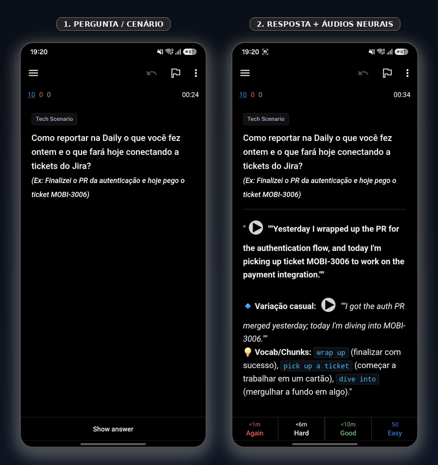

  

  <b>Inglês Técnico &amp; Repetição Espaçada para Engenheiros de Software</b> 
  <i>Baralhos prontos com áudio neural de estúdio, situações reais de engenharia corporativa e otimização FSRS.</i>

  
  
  
  

---

## Visão Geral

Este repositório foi criado para solucionar um desafio recorrente de desenvolvedores brasileiros em empresas multinacionais: dominar a escrita de código e a documentação técnica em inglês, mas travar na comunicação oral em chamadas síncronas (Daily Standups, 1-on-1s, Code Reviews, reuniões de System Design e negociações de débito técnico).

### Recursos Principais
* **Áudios Neurais Embutidos:** 100% dos cartões contêm arquivos `.mp3` gerados com vozes de inteligência artificial de alta fidelidade (Microsoft Edge Neural: Guy, Jenny, Eric e Aria).
* **Fórmula Dupla (Formal + Casual):** Treine a fala corporativa estruturada e a variação coloquial usada em canais do Slack e reuniões rápidas.
* **Tema AMOLED True Black:** Estilizado em `#000000` absoluto para alto contraste e economia de bateria em telas OLED/AMOLED de celulares e computadores.
* **Otimização FSRS:** Configurado para o algoritmo moderno de repetição espaçada do Anki.

---

## Catálogo de Baralhos

Clique nos botões de download direto para baixar os pacotes `.apkg` oficiais prontos para importação:

| Baralho | Total de Cards | Áudios | Foco Principal | Download Direto (RAW) |
| :--- | :--- | :--- | :--- | :--- |
| **English - Tech & Engineering** | 86 cards | 172 áudios | Dailies, Code Review, Arquitetura, System Design, Pushback e Gestão de Incidentes | [📥 Baixar .apkg](https://github.com/JonathanAJ/english-for-engineers/raw/main/decks/English_Tech_and_Engineering.apkg) |
| **English - Phrasal Verbs de TI** | 30 cards | 30 áudios | Verbos compostos essenciais: *spin up*, *tear down*, *roll out*, *chime in*, *flesh out*, *drill down* | [📥 Baixar .apkg](https://github.com/JonathanAJ/english-for-engineers/raw/main/decks/English_Phrasal_Verbs_TI.apkg) |
| **English - Small Talk Corporativo** | 30 cards | 60 áudios | Quebra-gelo nos 3 minutos antes da reunião, papo de segunda e sexta, 1-on-1s e fusos horários | [📥 Baixar .apkg](https://github.com/JonathanAJ/english-for-engineers/raw/main/decks/English_Small_Talk_Corporativo.apkg) |
| **English - Connected Speech & Reductions** | 30 cards | 30 áudios | Treino auditivo (*Ear Training*): decodificar a fala rápida de nativos (*Whaddya*, *Gonna hafta*, *Coulda*) | [📥 Baixar .apkg](https://github.com/JonathanAJ/english-for-engineers/raw/main/decks/English_Connected_Speech.apkg) |

> Todos os pacotes `.apkg` já possuem os arquivos de áudio embutidos internamente. Ao abrir o arquivo, o Anki descompacta a mídia de forma automática.

---

## Demonstração no Aplicativo Móvel (AnkiDroid / iOS)

  

---

## O Ecossistema Anki

Para utilizar os baralhos, você precisará do **Anki** instalado em seu computador ou smartphone. O Anki é gratuito e de código aberto:

| Plataforma | Aplicativo | Link Oficial |
| :--- | :--- | :--- |
| **Desktop (Linux / macOS / Windows)** | Anki Desktop | [apps.ankiweb.net](https://apps.ankiweb.net/) |
| **Android** | AnkiDroid | [Google Play Store](https://play.google.com/store/apps/details?id=com.ichi2.anki) |
| **iOS (iPhone / iPad)** | AnkiMobile | [Apple App Store](https://apps.apple.com/app/ankimobile-flashcards/id373493387) |
| **Nuvem / Web** | AnkiWeb | [ankiweb.net](https://ankiweb.net/) *(Sincronização gratuita)* |
| **Documentação Oficial** | Manual do Anki | [docs.ankiweb.net](https://docs.ankiweb.net/) |

---

## Como Instalar e Configurar (1 Minuto)

1. Baixe o baralho desejado na tabela acima através do link **[📥 Baixar .apkg]**.
2. Abra o Anki e dê duplo clique no arquivo baixado (ou use o menu **Arquivo -> Importar** / tecla `Ctrl + I`).
3. O baralho será importado com todos os áudios e estilizações visuais aplicadas.

### Configurações Recomendadas no Anki
* **Algoritmo FSRS:** Nas opções do baralho (ícone de engrenagem ao lado do nome do baralho -> *Opções*), ative o **FSRS** e defina a retenção desejada entre `0.85` e `0.90`.
* **Meta Diária:** Mantenha entre `5` e `10` novos cards por dia. A consistência diária é mais eficiente do que grandes volumes esporádicos.
* **Tema Escuro no Celular:** No AnkiDroid, acesse *Configurações -> Aparência -> Tema Escuro* e selecione **Preto Puro (AMOLED)** para aproveitar o fundo `#000000`.

---

## Metodologia de Estudo Diário (15 Minutos)

Para desenvolver fala natural sem tradução mental:

1. **Active Recall + Vocal Shadowing (10 minutos):**
   * Ao visualizar o cenário na frente do cartão, tente formular a resposta em voz alta antes de virar.
   * Ao virar, escute o áudio e repita a frase em voz alta com a mesma cadência, ritmo e entonação.
2. **Simulação Pré-Daily (5 minutos):**
   * Antes da sua Daily real, pegue os tickets do Jira do seu dia e monte mentalmente seu reporte em 3 frases usando os blocos aprendidos:
     * *Yesterday I wrapped up...*
     * *Today I'm diving into ticket MOBI-XXXX to work on...*
     * *No blockers on my end / I'm currently blocked waiting on...*

---

## Cheat Sheet de Sobrevivência (Consulta Rápida)

Frases corporativas de alto impacto para consulta imediata durante o expediente:

### Falhas de Áudio e Conexão
* *"Sorry about that, I was on double mute! Can everyone hear me clearly now?"*
* *"Your audio cut out for a second there. Would you mind repeating that last requirement?"*
* *"You're breaking up slightly. Could you please paste that link in the chat?"*

### Reporte de Impedimentos (Blockers)
* *"I'm currently blocked by the payment gateway team. I've reached out on Slack and I'm waiting on their response."*
* *"I ran into a few edge cases while handling concurrent transactions, so this took a bit longer than originally estimated."*

### Alinhamentos Rápidos e Foco
* *"Let's take this offline to keep the standup moving, and we can sync on Slack right after."*
* *"Do you have five minutes for a quick huddle after this? I'd love to bounce an idea off you regarding the API schema."*

### Pushback Técnico e Prazos
* *"While we could rush a quick patch by Friday, it would accumulate massive technical debt. I strongly suggest taking an extra sprint to build it properly."*
* *"I don't have that metric off the top of my head, but I'll pull the production logs and get back to you with the data right after this call."*
* *"That sounds like a great enhancement, but it's outside our current sprint scope. Let's log it in the backlog so we can prioritize it for sprint N+1."*

---

## Estrutura do Repositório

* `decks/`: Arquivos `.apkg` oficiais compilados com áudios embutidos.
* `src/tsv/`: Arquivos de texto tabulados com as perguntas, respostas e marcações de som.
* `docs/assets/`: Ativos visuais do repositório (logotipo vetorial SVG).

---

## Como Contribuir

Sugestões de novos cenários, expressões regionais ou melhorias nas frases técnicas são bem-vindas. Consulte as orientações em [`CONTRIBUTING.md`](CONTRIBUTING.md).

---

## Licença

Distribuído sob a licença MIT. Veja [`LICENSE`](LICENSE) para mais informações.
